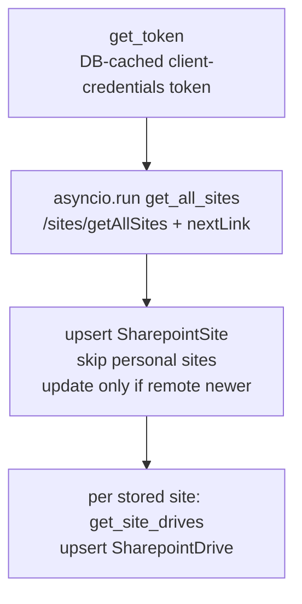

# SharePoint Sync

> **Status (2026-09-10):** Sites and Drives sync is **live** and idempotent.
> Site membership (`SharepointSiteMember`) is **not** synced — it is curated by
> hand in the admin. See [Site membership](#site-membership-manual) below.

This page documents the offline SharePoint synchronisation: the `populate_sites`
management command, the `pwms/utils/sharepoint.py` Graph client, the
`SHAREPOINT_*` settings, and the local `Sharepoint*` models.

Related pages: [Management Commands](./Management%20Commands.md) ·
[Roadmap & Planned Integrations](./Roadmap%20&%20Planned%20Integrations.md).

---

## What it does

`populate_sites` mirrors a SharePoint tenant into local Django tables so the
rest of the app can work offline (no live Graph calls per page view):

| Local model | Remote source | Upsert key |
| --- | --- | --- |
| `pwms.SharepointSite` | `GET /sites/getAllSites` | `site_id` |
| `pwms.SharepointDrive` | `GET /sites/{id}/drives` | `(site, drive_id)` |

`SharepointSiteMember` is **not** part of the sync: membership is an access
control decision and is maintained by hand in the admin (see
[Site membership](#site-membership-manual)).

These tables store **Graph identifiers and URLs** — values this app neither
generates nor bounds — so their columns are sized to hold what Graph returns
rather than to a tidy guess: the id columns (`site_id`, `drive_id`, `folder_id`)
allow 512 characters, the name columns 500, and the URL columns 2048. That
matches `pwms.Attachment`, which holds the same identifiers for the documents it
points at. (`SharepointFolder` is not synced here; the picker mirrors a folder
on demand when a document inside it is attached.) Migration `0038` widened these
after a real Graph folder id overflowed `varchar(200)` — which blocked *every*
“attach a document inside a folder” action, since the folder row could never be
written. The same migration widened `WorkflowEvent.document_url`, for the same
reason: the attachment service copies `Attachment.sharepoint_web_url` into the
record's `document-attached` event, and a real `webUrl` in this tenant already
runs to 249 characters. Migration `0042` extended the same reasoning to the links
a *user* pastes rather than the app writes: the workflow `*_document_url` fields
(`DelegationReport.report_document_url`,
`DelegationReportUpdate.atc_document_url`, `InternationalAgreement`'s
`agreement_document_url` / `explanatory_memorandum_url`, `Bill.bill_document_url`,
`BillVersion.document_url`, `WorkflowReferral.response_document_url`) now allow
2048 as well — at 200 they refused exactly the links the app hands out elsewhere.

Run it from the repo root:

```bash
.venv/bin/python manage.py populate_sites
```

The command is **safe to re-run**: it upserts, never deletes rows, and skips a
record when the remote copy is not newer than what is stored.

---

## Prerequisites & configuration

The app authenticates to Microsoft Graph with an **application token**
(OAuth 2.0 client-credentials flow) — i.e. a service principal / "system
account", not a user. There is no interactive login.

Environment variables (read by `python-decouple` from `.env` at the repo root):

| `.env` key | Settings attribute | Purpose |
| --- | --- | --- |
| `CLIENT_ID` | `SHAREPOINT_CLIENT_ID` | Azure AD app (client) ID |
| `CLIENT_SECRET` | `SHAREPOINT_CLIENT_SECRET` | Azure AD app client secret |
| `TENANT_ID` | `SHAREPOINT_TENANT_ID` | Azure AD tenant ID |

Derived automatically in `settings.py`:

- `SHAREPOINT_TOKEN_URL` = `https://login.microsoftonline.com/{TENANT_ID}/oauth2/v2.0/token`
- `SHAREPOINT_SCOPE` = `https://graph.microsoft.com/.default` (app-only, grants
  whatever the app registration has been consented for)

### Events document locations

The **Events** tab's document field is a SharePoint picker when the record has a
location:

- a **bill** uses its own B-number folder under the Bill Folder (`BILL_DRIVE` /
  `BILL_FOLDER`), created when first needed;
- every other type uses the folder configured in
  `WORKFLOW_TYPE_SHAREPOINT_LOCATIONS`, keyed by `WorkflowType.name`:

```python
WORKFLOW_TYPE_SHAREPOINT_LOCATIONS = {
    "Delegation Report": {
        "drive_id": "…",
        "folder_id": "…",       # blank / "root" = the drive root
        "name": "Delegation reports",  # optional UI label
    },
}
```

An entry without a `drive_id` leaves the plain URL input in place. A configured
drive is resolved into the local `SharepointDrive` mirror on first use if
`populate_sites` has not already synced it.

### Token handling

`pwms.utils.sharepoint.get_application_token()` (aliased as `get_token()`):

1. Reuses the most recent **active** cached `pwms.SharepointToken` row if it has
   not expired (there is a 5-minute safety buffer before the real expiry).
2. Otherwise requests a fresh token from `SHAREPOINT_TOKEN_URL` using
   `client_credentials`, deactivates the old active row(s) and stores the new
   token in `pwms.SharepointToken`.

So a valid token is cached in the database after the first run; you do not pass
a token on the command line.

---

## What happens on each run

The `handle()` pipeline in `populate_sites`:



### 1. Sites (`_process_sites`)

- Calls `GET /sites/getAllSites?$top=200&$select=…` and follows `@odata.nextLink`
  until exhausted (the previous code only fetched the first page and silently
  truncated large tenants).
- OneDrive **personal sites** (`isPersonalSite`) are filtered out.
- New sites are `bulk_create`d; existing sites are updated **only when** the
  remote `lastModifiedDateTime` is newer than the stored
  `remote_modified_at` (or when either side lacks a timestamp).
- Tracks `last_synced_at` (when we last pulled) alongside the remote
  `remote_modified_at`.

### 2. Drives (`_process_drives`)

- For every stored site, calls `GET /sites/{site_id}/drives?$select=id,name`
  (pagination-aware) and upserts `SharepointDrive` rows.
- A failure on one site is logged and the loop continues; it never aborts the
  whole run.

### Site membership (manual)

`populate_sites` does not read or write `SharepointSiteMember`. Membership
grants access to a site in the attachment picker, and reading site permissions
from Graph would need `Sites.Manage.All` / `Sites.FullControl.All`. Rather than
mirror an incomplete picture, rows are curated deliberately in the admin — an
inline on the site page and a standalone **Sharepoint site members** list.

Rows are unique on `(site, user)` and carry `is_active`; the picker lists only
active rows. To empty the table in bulk — for example before rebuilding access
after a reorganisation — use `reset_site_members`:

```bash
.venv/bin/python manage.py reset_site_members --dry-run
.venv/bin/python manage.py reset_site_members --site "Committee Library"
.venv/bin/python manage.py reset_site_members --inactive-only
```

See [Management Commands](./Management%20Commands.md#sharepoint-graph-sync).

---

## Idempotency & safety

- Re-runnable any number of times.
- Rows are never hard-deleted by this command: sites and drives are upserted,
  and membership is left untouched.
- Locally curated columns are excluded from the sync's update list, so a re-run
  never undoes an administrator's change — in particular
  `SharepointSite.enabled`, the flag that gates the attachment picker above.
- Updates are conditional on the remote timestamp (sites).
- Writes happen inside `transaction.atomic()` per batch.

---

## Graph endpoints used

| Purpose | Endpoint | Helper |
| --- | --- | --- |
| Token (app-only) | `POST …/oauth2/v2.0/token` | `get_application_token` |
| All sites | `GET /sites/getAllSites` | `get_all_sites` |
| Site drives | `GET /sites/{id}/drives` | `get_site_drives` |
| Drive root children | `GET /sites/{id}/drive/root/children` | `get_site_details` |
| Drive items / folders | `GET /drives/{id}/root/children`, `/items/{fid}/children` | `get_drive_items`, `get_folder_items` |
| Item metadata | `GET /drives/{id}/items/{iid}` | `get_item` |
| Item versions | `GET /drives/{id}/items/{iid}/versions` | `get_item_versions` |
| Version content | `GET …/versions/{vid}/content` (302) | `get_version_download_url` |
| File upload / folders | `PUT …:/content`, `POST …/createUploadSession`, `POST …/children` | `upload_file`, `create_folder` |

The item/upload helpers are driven by the attachment picker (below) rather than
by a management command.

---

## Attachments (documents on workflow records)

Every workflow instance (`DelegationReport`, `InternationalResolution`,
`InternationalAgreement`, `Bill`) has an **Attachments** section on its detail
page. It is a lazy HTMX picker that browses SharePoint and attaches documents to
the record through `pwms.Attachment` — a generic FK (`content_type` +
`object_id`), so one table serves every concrete subclass.

The flows the picker supports:

1. **Browse** — the tree lists the sites the user is an active
   `SharepointSiteMember` of (superusers see every enabled, non-personal
   mirrored site), expanding to their drives and folder hierarchy. Only
   **enabled** sites are offered: `SharepointSite.enabled` is a local curation
   flag (uncheck it in the admin to hide a library from the picker) and it binds
   everyone, superusers included. Sites and drives come from the local mirror; a
   folder's children are read from Graph on demand (`get_folder_items`).
2. **Select** — opening a folder lists its documents; **Attach** links an
   existing file (`get_item` for its metadata) as a new `Attachment`.
3. **Upload & attach** — the folder's upload form sends a local file straight to
   SharePoint (`upload_file`) and records the returned item as an attachment in
   the same step.
4. **Version history** — a document's row opens a panel listing SharePoint's own
   versions (label, size, author, timestamp), refreshed from
   `get_item_versions` each time it is opened; each version links to a download
   that resolves its pre-authenticated SharePoint URL.
5. **Activity** — every attach, detach and superseding upload is appended to the
   record's domain event log (see below), and the section lists the recent ones.

Graph is authenticated with the same DB-cached application token as the sync
(`get_application_token`), so no interactive login is involved. Access is
narrowed twice: the **record's** RBAC (`edit`, via
`pwms.services.permissions.resolve`) gates the mutating picker calls and `view`
gates reading a version history, while **site membership** gates the SharePoint
content itself.

### Endpoints

| Route | Method | Purpose |
| --- | --- | --- |
| `attachments/browser/` | GET | The picker shell (tree + document panel) |
| `attachments/tree/` | GET | One expanded tree level: a site's drives, or a folder's subfolders |
| `attachments/folder/` | GET | The documents in a selected folder, plus its upload form |
| `attachments/link/` | POST | Attach an existing document |
| `attachments/upload/` | POST | Upload a file into the selected folder and attach it |
| `attachments/<public_id>/delete/` | POST | Detach a document (the file stays in SharePoint) |
| `attachments/<public_id>/versions/` | GET | Version history for one attachment, refreshed from SharePoint |
| `attachments/versions/<public_id>/download/` | GET | Redirect to that version's pre-authenticated SharePoint URL |

The `content_type` (`"app.model"`) + `object_id` parameters name the target
record, so the routes are shared by every workflow subclass. Deleting an
attachment removes only the local row; it never deletes the file.

Code: the `attachment_*` views in `pwms/views.py`, the service in
`pwms/services/attachments.py`, the models in `pwms/models/attachments.py`, and
the fragments in `pwms/templates/pwms/partials/attachment_*.html`.

### Version history

`populate_sites` mirrors *sites*, not documents, so version history is mirrored
on demand: `sync_versions()` reads `get_item_versions` and upserts one
`pwms.AttachmentVersion` per remote version (unique on attachment + version id),
flagging the newest `is_current`. The panel is served by that same call, so
opening it always shows fresh data; a version SharePoint no longer reports is
left in place rather than deleted.

Downloading a version never streams the file through the app:
`get_version_download_url` reads the `Location` header of Graph's redirect and
`attachments/versions/<public_id>/download/` forwards the browser to that
short-lived, pre-authenticated URL.

Re-uploading a document with the same folder + filename returns the *same*
SharePoint item, so `upload_document()` refreshes the existing attachment in
place (size, MIME type, URLs) instead of raising “already attached”, and records
the change as a new version. Its original attachment **type** is kept — a
revision does not reclassify a document.

### The document audit trail

Attaching, detaching and revising are recorded as `WorkflowEvent`s on the target
record's **append-only domain event log** (see
[Data Model §5](./Data%20Model.md#5-auditing)), through three seeded
`EventType`s — `document-attached`, `document-detached` and
`document-version-added` (migration `0031`). They surface as the section's
“Document activity” list, in the record's **Events** tab, and on its **Timeline**.

This is deliberately *not* inferred from `Attachment.created_at`: a detach
deletes the row, so the event payload carries a **snapshot** of the document
(name, item id, drive, folder path, URL) that outlives it, alongside the `actor`
and timestamp. Detaching removes only the local link — the file and its version
history stay in SharePoint. Recording is best effort: a target with no event log,
or a registry whose event type has been removed, is warned about and skipped so
a document can still be filed.

Each row's **open** link goes through the app rather than to SharePoint: the
attachment's name points at `attachments/<public_id>/open/`, which resolves a
**fresh** pre-authenticated URL for the document and bounces the browser to it.
That URL carries its own authorisation, so the reader never signs in to
SharePoint — the application token did the authenticating. It is also why the link
cannot simply be stored and rendered: SharePoint issues these for about an hour,
so the copy in `Attachment.download_url` is usually stale by the time anyone
clicks it. VIEW on the owning record is required, exactly as for its detail page,
so the endpoint can only hand out documents the reader could already open.

An activity row for a document that is still attached opens the same way. One for
a document since **detached** falls back to the snapshot URL its event recorded —
there is no attachment row left to resolve a fresh link from.

The picker's own file list still links to `webUrl`, because a file being browsed
has no attachment row yet, and accepting a drive/item id from the browser in order
to mint a link is not something the app will do.

A row that had to be **reconstructed** carries `payload["backfilled"] = True`
and `origin="system"` with no actor: migration `0039` restored the
`document-attached` events lost to the 200-character `document_url` column, and a
restored event records that the system wrote it long after the fact rather than
inventing an actor. Its timestamp is the attachment's own, not the migration's.

> **Dependency:** browsing is membership-based, so a user needs an **active**
> `SharepointSiteMember` row for the site. These rows are curated in the admin
> (see [Site membership](#site-membership-manual)); until one exists, only
> superusers see a populated tree.

---

## Troubleshooting

| Symptom | Likely cause / fix |
| --- | --- |
| `SHAREPOINT_TOKEN_URL not configured` / empty `CLIENT_ID`/`CLIENT_SECRET` | `.env` missing `CLIENT_ID`, `CLIENT_SECRET` or `TENANT_ID` at the repo root |
| Token request `HTTP 401/400` | wrong client id/secret or tenant; check Azure AD app registration |
| Sites fetched but a large tenant looks incomplete | should no longer happen — `get_all_sites`/`get_site_drives` follow `@odata.nextLink` |
| A user cannot see a site in the picker | they have no **active** `SharepointSiteMember` row, or the site is disabled — add the member on the site's admin page |
| Drives empty for a site | that site may genuinely have no document library |
| Command fails early | token expired **and** no cached active row → re-run after granting/refreshing consent |

---

## Related

- `pwms/utils/sharepoint.py` — the Graph client (imports `SharepointToken` from `pwms.models`).
- `pwms/models/sharepoint.py` — `SharepointSite`, `SharepointDrive`,
  `SharepointSiteMember`, `SharepointToken`, `SharepointFolder`.
- [Roadmap & Planned Integrations](./Roadmap%20&%20Planned%20Integrations.md) —
  what remains on top of this sync (restoring a superseded version, pinning a
  version to a record).
