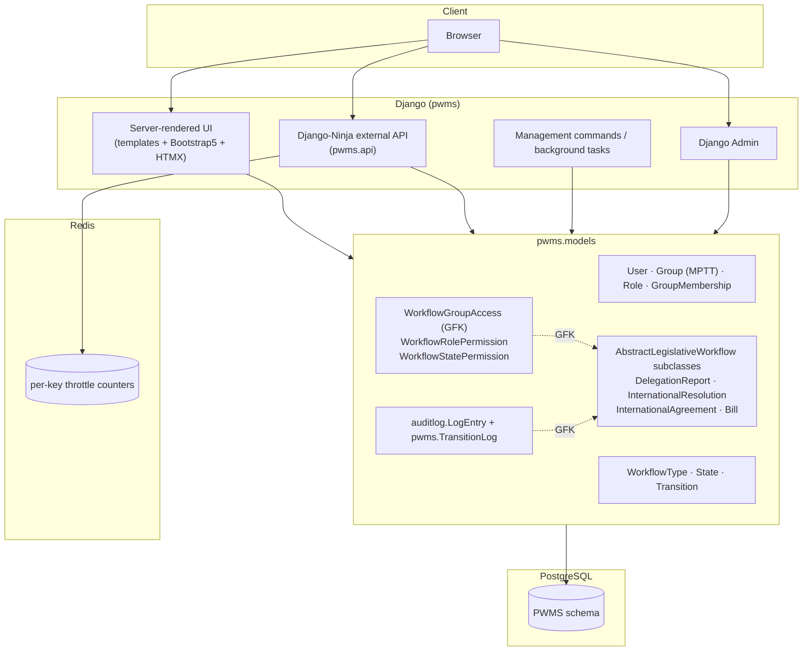
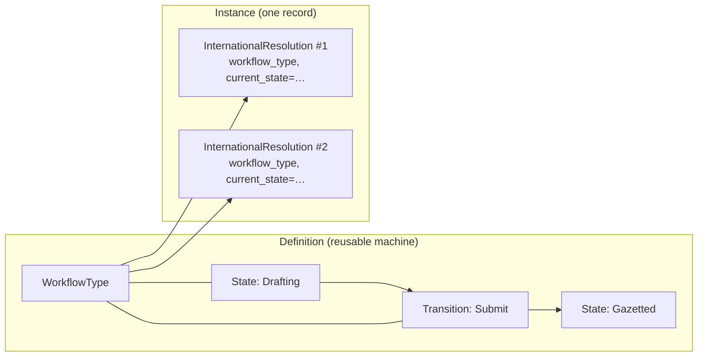
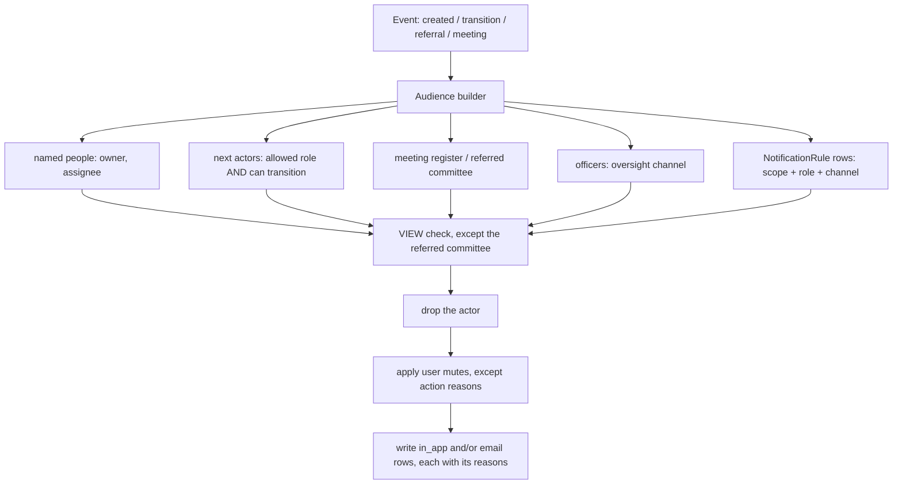
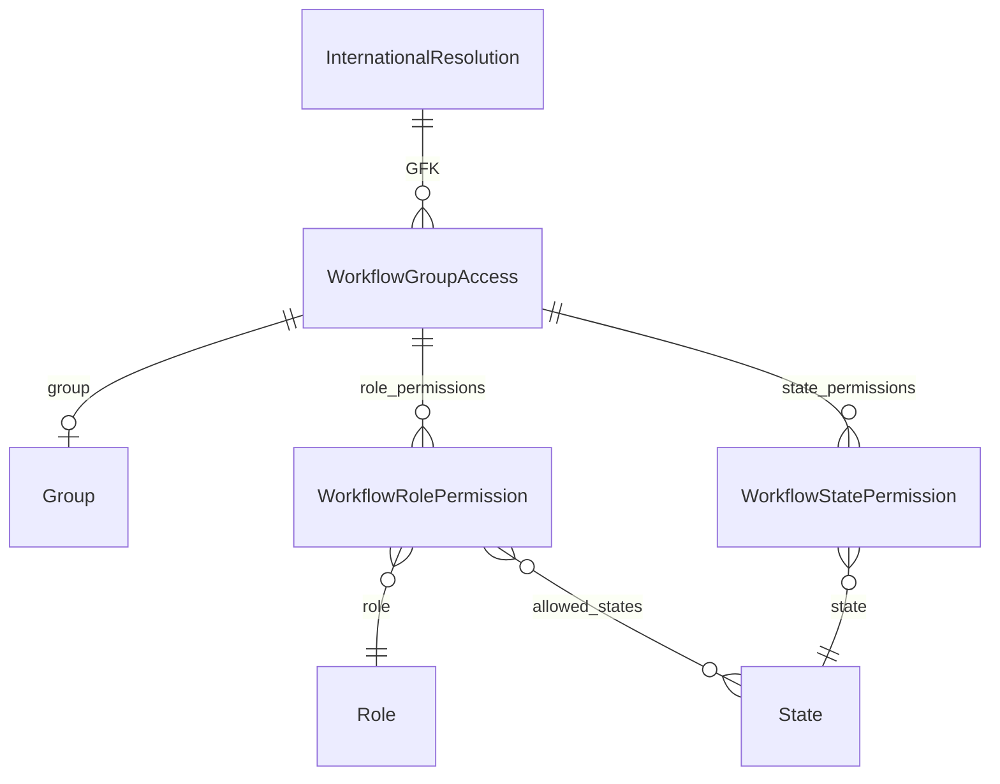
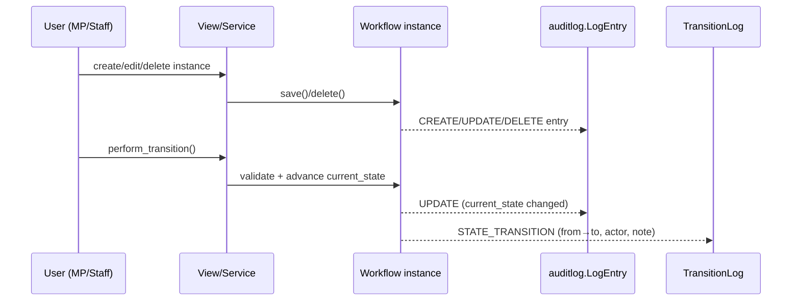

# System Design

PWMS models parliamentary workflow as two cooperating layers:

1. **A reusable state machine** (`WorkflowType` → `State`/`Transition`) that
   describes how a kind of legislative instrument moves through Parliament.
2. **Workflow instances** — concrete records (e.g. `InternationalResolution`)
   that share one abstract schema and simply point at a machine and a
   `current_state`.

All **authorisation** and **auditing** are layered on top of the instance.

---

## 1. High-level architecture



### Module map

```
pwms_project/                     # repo root (git) — run manage.py from here
├── manage.py                     # entry point
├── .env                          # python-decouple secrets
├── pyproject.toml / uv.lock      # uv-managed dependencies (distribution: pwms)
├── logs/                         # runtime logs
└── src/pwms/                     # single top-level package (installed as `pwms`)
    ├── settings.py               # env-driven settings (python-decouple)
    ├── root_urls.py              # project URL root (admin, pwms, api, docs)
    ├── asgi.py / wsgi.py
    ├── tasks.py                  # django-background-tasks entry points
    ├── templates/                # server-rendered UI (Bootstrap 5 + HTMX)
    ├── static/                   # CSS / JS / images
    ├── admin.py                  # admin registrations
    ├── apps.py                   # PwmsConfig; ready() registers auditlog
    ├── urls.py / views.py        # app pages under /pwms/ (dashboard, auth, groups,
    │                             #   workflow CRUD, attachments, alerts, reports)
    ├── backends.py               # GracefulLDAPBackend + local fallback
    ├── middleware.py             # login-required-by-default middleware
    ├── decorators.py / navigation.py
    ├── models/
    │   ├── base.py               # BaseModel (uuid7 public_id, timestamps)
    │   ├── users.py              # User
    │   ├── groups.py             # Group (MPTT)
    │   ├── permissions.py        # Role, GroupMembership
    │   ├── geography.py          # Country, City (reference data)
    │   ├── sharepoint.py         # SharePoint sync models
    │   ├── attachments.py        # Attachment, AttachmentVersion
    │   ├── notifications.py      # Notification (bell + outbound-email log), NotificationRule, NotificationPreference
    │   ├── reports.py            # ReportShare
    │   ├── workflows.py          # engine + instances + RBAC + events
    │   ├── meetings.py          # Meeting + MeetingAttendance (the Events workflow)
    │   └── venues.py            # Building + Venue (on-premises venue catalogue)
    ├── api/
    │   ├── api.py                # NinjaAPI, routers and the read-only endpoints
    │   ├── models.py             # ApiClient, ApiRefreshToken, ApiUsageLog
    │   ├── auth.py / tokens.py   # bearer auth, signed access + rotating refresh tokens
    │   ├── scopes.py             # users:read / memberships:read / bills:read
    │   └── throttling.py         # per-key rate limit + IP-scoped token throttle
    ├── notifications/            # audience building, preferences, dispatch, share logging, bell context
    ├── reporting/                # builder, exports, instruments, sharing
    ├── membership/
    │   ├── resolver.py          # GroupResolver: Oracle pair -> seeded Group (+ group_aliases.csv)
    │   ├── group_aliases.csv    # curated Oracle org -> seeded path table
    │   ├── sync_service.py      # MembershipSyncService (resolver-backed)
    │   └── org_hierarchy.py     # reporting-tree analysis + shared name helpers
    ├── services/
    │   ├── permissions.py        # unified permission resolver (UI + API)
    │   ├── attachments.py        # SharePoint attachment service
    │   ├── history.py            # merged TransitionLog + WorkflowEvent + auditlog timeline
    │   ├── meetings_io.py        # meeting CSV/XLSX import + export
    │   └── progress.py           # where a record sits in its state machine
    ├── management/commands/      # sync, jobs, diagrams (see Management Commands)
    ├── utils/                    # audit_helpers.py, sharepoint.py, diagrams.py
    ├── migrations/
    ├── tests*.py                 # tests, tests_api, tests_meetings, tests_notifications, tests_notification_audience, …
    └── docs/                     # this documentation
```

---

## 2. URL map

| Path | Purpose | Auth |
| --- | --- | --- |
| `/admin/` | Django admin | admin |
| `/` | redirect → `/pwms/` | – |
| `/pwms/` , `/pwms/about/` , `/pwms/contact/` | public pages | public |
| `/pwms/dashboard/` | dashboard (figures scoped to the user) | session |
| `/pwms/login/` , `/pwms/logout/` | session login/logout (web) | – |
| `/pwms/workflows/…` | list / detail / create / update / delete per instrument (incl. bill versions) | session + RBAC |
| `/pwms/instruments/{public_id}/document/` | one instrument as a formal PDF/HTML document | session + RBAC |
| `/pwms/instruments/{public_id}/diagram.svg` | the workflow type's generated state-machine diagram | session + RBAC |
| `/pwms/instruments/{public_id}/transition/` | confirm (GET) and apply (POST) one state transition | session + RBAC |
| `/pwms/attachments/…` | SharePoint picker + open / link / upload / detach / version history | session + RBAC |
| `/pwms/alerts/` , `/pwms/alerts/{public_id}/` | alerts page and open/read state | session |
| `/pwms/alerts/preferences/` | the user's own bell/email mute switches per alert kind | session |
| `/pwms/reports/…` | report builder, HTMX preview, export, share | session + RBAC |
| `/pwms/reports/shared/{token}/` | read-only shared report (token-addressed) | token |
| `/pwms/meetings/` (`?view=month|week|day` , `&week_start=`) , `/pwms/meetings/calendar/` , `/pwms/meetings/calendar.json` | meeting calendar dashboard (colour-coded month/week/day layouts, configurable week start), its HTMX calendar body, and the JSON feed | session |
| `/pwms/meetings/new/` (`?date=`, `?time=`) , `/pwms/meetings/{public_id}/` (`/edit/`, `/delete/`) | meeting create (prefilled from a calendar day) / detail / edit / delete | session + RBAC |
| `/pwms/meetings/export/` (`?format=csv\|xlsx`) , `/pwms/meetings/import/` , `/pwms/meetings/import/template/` | meeting CSV/XLSX export download, bulk import (upsert), and the blank import template — see [Meetings Import & Export](./Meetings%20Import%20%26%20Export.md) | session + RBAC |
| `/pwms/meetings/{public_id}/attendance/…` | add an invitee / record / remove an attendee, regenerate the register, and email the summary | session + RBAC |
| `/pwms/meetings/{public_id}/agenda/` , `/pwms/meetings/{public_id}/agenda/edit/` | the agenda panel and its inline (HTMX) rich-text editor | session + RBAC |
| `/pwms/meetings/{public_id}/minutes/` | advance the minutes status (draft / filed / approved) | session + RBAC |
| `/pwms/*-search/` | HTMX search fragments (users, groups, reports, countries, cities) | session |
| `/api/v1/` | external API root (resources visible to the calling key) | bearer token |
| `/api/v1/me/` | the calling client registration, scopes and rate limit | bearer token |
| `/api/v1/auth/token/` (`refresh/`, `revoke/`) | obtain / rotate / revoke a token pair | – (IP-throttled) |
| `/api/v1/{users,groups,memberships,bills}/` | read-only resource lists, filtered and paginated; `search`/`search_fields` match multiple fields | bearer token + scope |
| `/api/v1/{users,groups,memberships,bills}/{public_id}/` | read-only resource detail | bearer token + scope |
| `/api/v1/search/` | cross-resource search over users, groups, memberships and bills (scoped, paginated groups) | bearer token + any read scope |
| `/api/v1/docs` , `/api/v1/openapi.json` | Swagger UI + OpenAPI document | public (docs) |

---

## 3. The workflow engine

### Two levels — definitions vs instances



- **`WorkflowType`** — a registry entry (name, slug, enabled) **owned by a
  `Group`** (`group`, the RBAC scope) with a `create_roles` M2M drawn from that
  group's roles. Owns its `State`s and `Transition`s. States/transitions are
  **shared** by every instance of that type — they are not duplicated per record.
- **`State`** — name/slug, flags (`is_initial`, `is_terminal`,
  `allows_referrals`), ordering and colour; unique per workflow type.
- **`Transition`** — an allowed `from_state → to_state`, with `allowed_roles`
  (**advisory** — a diagram label that `next_actor_roles()` uses to say whose turn
  it is after the move, *not* an authorisation rule: who may move a record on is
  the `transition` RBAC capability, see §4); may require a comment; unique per
  workflow type. Who is *alerted* about it is declared with
  `NotificationRule` rows (`transition` FK), not on the transition itself.
- **`NotificationRule`** — one explicit alert-audience declaration on a workflow
  type: `event`, optional `transition`, `scope`, `role`, `channel`, `is_active`.
  See [§ Alert audiences](#alert-audiences) below.

### Instances

`AbstractLegislativeWorkflow` is the **abstract common schema**:

- `workflow_type` → the machine it follows
- `current_state` → where it is now (must belong to `workflow_type`)
- `title`, `description`, `owner`, `assigned_to`, `deadline`, `priority`
- referrals are typed `WorkflowReferral` rows (GFK) — see §5
- notes are typed `WorkflowNote` rows (GFK) — usable by every subclass, so no
  instrument needs a `notes` column to carry a note log

Because the base is abstract, every concrete subclass gets its own table. Today
that is:

- **`DelegationReport`** — BRS report fields (engagement, location, ATC links).
- **`InternationalResolution`** — `resolution_number`, `adoption_date`,
  `responsible_group`, `implementation_progress`; may nest inside a report.
- **`InternationalAgreement`** — `reference_number`, `agreement_type`,
  `submitting_department`, `responsible_minister`, ATC tabling fields.
- **`Bill`** — `bill_number`, `short_title`, `bill_type`, `house_of_origin`,
  sponsor and responsible committee, with `public_status` derived from the state
  and a preserved `BillVersion` history.
- **`Meeting`** — the Events workflow: `meeting_type` (House Plenary, committee,
  administration, …), `start_datetime` / `end_datetime`, an on-premises `venue`
  (a room in a `Building`) or free-text `off_site_venue` / `off_site_address`, an
  `attendance_mode` (on the premises / hybrid / virtual), the convener
  `host_group`, chair/secretary and `quorum`, with the agenda and minutes carried
  as attachments and attendance recorded on the `MeetingAttendance` child rows.

Helpers on the base provide lifecycle navigation:

| Method | Purpose |
| --- | --- |
| `clean()` | validate `current_state` belongs to `workflow_type` |
| `get_available_transitions()` | transitions valid from `current_state` |
| `perform_transition(transition, actor, comment, ip)` | validate → advance state → write a `TransitionLog` |
| `can(user, action)` | effective RBAC resolution (see §4) |
| `group_accesses()` / `audit_logs()` | access & audit rows for this instance |

> **Design rule:** Django cannot create a `ForeignKey` to an *abstract* model
> (`fields.E300`). Cross-cutting tables that must point at *any* workflow subclass
> therefore use a **GenericForeignKey** (`WorkflowGroupAccess`, `TransitionLog`).

### Alert audiences

Who hears about an event is **declared**, not an accident of RBAC. Everything
lives in `pwms/notifications/` (`dispatch.py`, `preferences.py`) and three models
in `models/notifications.py` / `models/workflows.py`.



- **`Audience`** collects `Recipient`s: a user, the **reasons** they were chosen
  and the channels (`in_app`, `email`) those reasons grant. Someone chosen twice
  appears once with both reasons and the union of the channels.
  `stakeholders(instance, event=, transition=)` builds it for records and
  `referral_audience(referral, event=)` for referrals; `alert(audience=...)`
  consumes it. The reasons are `next-actor`, `assignee`, `referred-group`,
  `owner`, `referrer`, `participant`, `officer` and `rule:<id>`.
- **Scope** is how a shared `Role` avoids becoming a blast. The groups an event
  concerns (`event_groups()`) are the **custodian** (`WorkflowType.group`) plus a
  meeting's **host group** or a referral's **referred group** — *not* every group
  with an access row. Email additionally requires the person to be active staff
  in one of those groups (`staff_recipients()`); the bell does not.
  A type with no custodian falls back to the record's own access groups so an
  audience never silently vanishes.
- **Next actors** are the holders of a role allowed on a transition available from
  the new state, **who can also `transition` the record** (`resolve(...,
  TRANSITION)`). Holding the role is not enough: a referral gives a committee
  access but never `transition`, so it is not "next".
- **Oversight**: the type's officers (create roles in the owning group) are told at
  `WorkflowType.oversight_channel` (default **email only**). `notify_next_actors`
  and `notify_named_people` are plain booleans on the type.
- **`NotificationRule`** rows add recipients per type/event. `clean()` rejects an
  inconsistent rule (a transition on a non-transition event, another type's
  transition, `referred_group` on a non-referral event, `host_group` on a
  referral event). `scope=instance_groups` is the explicit wide option.
- **`NotificationPreference`** is a per-user, per-kind pair of mute switches. It
  runs *after* the audience is built and can only remove a channel; it is skipped
  for `Recipient.must_act` (`next-actor`, `assignee`, `referred-group`) and for
  `MANDATORY_KINDS` (`referral-deadline`). No row means "as the rules say", and a
  row with both switches on is deleted, so the table holds only exceptions.
- **VIEW is re-checked** for every audience except the referred committee (the
  referral is its entitlement; the message states only the referral's own
  facts).

| Event (rule `event`) | Default audience | Resolved in |
| --- | --- | --- |
| `created` (`workflow-created`, `meeting-created`) | owner, assignee, officers (oversight), meeting register | custodian (+ host group) |
| `transition` (`workflow-transition`, `meeting-status`) | owner, assignee, **next actors**, officers, meeting register | custodian (+ host group) |
| `referral-created` | referred committee, owner, assignee | referred group |
| `referral-closed` (`-responded`, `-recalled`, `-expired`) | referred committee, owner, assignee, **referrer** | referred group (+ custodian for the referrer's email) |
| `referral-deadline` | referred committee, owner, assignee (not mutable) | referred group |
| `meeting-document`, `meeting-attendance` | owner, assignee, officers, meeting register | custodian + host group |

---

## 4. ContentType-based RBAC

**Creation** is scoped at the **type** level: a `WorkflowType` belongs to a
`Group` and lists the `create_roles` (roles held by members of that group) that
may create instances — `WorkflowType.can_create(user)` / `creatable_by(user)`.
Superusers bypass the check; an empty `create_roles` means superusers only.

**View / edit / delete / share / comment / manage / transition** on existing
rows are granted **per workflow instance** and are keyed to the instance via a
generic foreign key (`ContentType` + internal PK). There are three layers:



1. **`WorkflowGroupAccess`** — "which House/Committee may access this instance",
   plus group-level defaults `can_view/edit/delete/share/comment/manage/transition`,
   `is_primary`, grantor and grant time.
2. **`WorkflowRolePermission`** — per `(group_access × Role)` overrides of the
   seven capabilities. If a row exists it is *authoritative* for that role; an
   optional `allowed_states` M2M scopes the override to specific states.
3. **`WorkflowStatePermission`** — per `(group_access × State)` rows describing
   what the group may do *while the workflow is in that state* (e.g. view/edit in
   "Drafting" vs only view in "Gazetted").

### Resolution order (`instance.can(user, action)`)

For each Group the user actively belongs to (`GroupMembership`, active) that also
holds a `WorkflowGroupAccess` on the instance:

1. **Role override** — if a `WorkflowRolePermission` exists for the user’s role
   and applies in the current state, it wins (grant **or** explicit deny).
2. **State permission** — else a `WorkflowStatePermission` row for
   `(group_access, current_state)`.
3. **Group default** — else the base flags on `WorkflowGroupAccess`.

Actions are `view | edit | delete | share | comment | manage | transition`.

The **`PermissionResolver` service** (`pwms/services/permissions.py`) is the
single entry point the UI and API both call: `resolve(user, resource, action)`,
`permissions_for(user, resource)` (the six capabilities) and `require(...)`.
It dispatches by resource type — workflow instances go through `can(...)` above,
other models fall back to a conservative default or a registered resolver —
adds the superuser bypass, grants `manage` to anyone holding the global
`Role.can_manage_permissions` capability, and treats people named on a
workflow instance as implicitly authorised — its **owner** may always
view/edit/delete it and its **assignee** may always view it (assignment confers
reading rights only). A **meeting** additionally grants **view** to anyone on its
attendance register, so an invited committee member outside the unit that
administers the register can still open the meeting they were asked to attend.
The web UI consumes the same resolver through `require()` and the visibility
helpers in `pwms/services/permissions.py`.

---

## 5. Auditing

These mechanisms record history:

| Mechanism | Records | Granularity |
| --- | --- | --- |
| `auditlog.LogEntry` | every **create / update / delete** of a registered workflow instance | field-level before/after diffs, actor, IP, timestamp |
| `pwms.TransitionLog` | every **semantic state transition** | `from_state → to_state`, actor, comment, IP, action label |
| `pwms.WorkflowEvent` | every **domain event** (document attached, ATC published, referral created/responded/...) | append-only, typed registry (`EventType`), JSON payload, actor, origin |
| `pwms.Notification` | every **in-app alert and outbound email** (alerts and explicit report/record shares) | one row per recipient and channel, with subject, text/HTML body, envelope snapshot, status, attempts, error and the **reasons** the person was told |

- Registration happens in `PwmsConfig.ready()`: all four concrete subclasses
  (`InternationalResolution`, `DelegationReport`, `InternationalAgreement`,
  `Bill`) are registered with `exclude_fields=["updated_at"]`. Add each new
  concrete subclass there. Two child-row models are registered as well —
  `DelegationParticipant` (removal is a soft delete, so the row survives and
  auditlog keeps the actor) and `WorkflowNote` (a note is its own row, so it
  needs a trail of its own) — because they change without touching their parent.
  Extend that list for each new child model. Referral changes are no longer M2M
  audit entries — they are typed rows whose lifecycle emits `WorkflowEvent` rows.
- `perform_transition()` writes a `TransitionLog` row **and** the resulting
  `current_state` change is captured by auditlog as an UPDATE entry.
- The `Notification` log is **append-only at the admin layer**: both it and
  `ReportShare` are read-only and undeletable there. Alert email is queued (the
  row records retries and the final outcome); explicit share email sends inline
  and records one attempt per addressed recipient, including external addresses
  with no `User` account. `to_email` / `from_email` snapshot the envelope so a
  later profile or settings change cannot rewrite what was sent. `reasons`
  answers "why did I get this?" from the database (the *Why* column in the admin
  log).
- `utils/audit_helpers.py` exposes `get_audit_trail_for_instance(instance)` and
  `get_audit_trail_by_public_id(model_class, public_id)` used by the API.



---

## 6. API layer

- **Django-Ninja external API** (`pwms/api/`, mounted at `/api/v1/`)
  is the only API. It is aimed at registered partner applications rather than
  interactive users: app registrations, scopes, tokens, usage logs and
  throttling live in that app, and the endpoints are read-only for **users**,
  **groups**, **memberships** and **bills**.
- Credentials are an application `client_id`/`client_secret`, exchanged for a
  **60-minute signed access token** and a **24-hour, single-use refresh token**.
  Access tokens are re-validated against the client's active flag and current
  scopes on every request.
- **OpenAPI** is generated by Django-Ninja (schema at
  `/api/v1/openapi.json`, Swagger at `/api/v1/docs`).
- The previous **DRF API** (the old `/api/` routes and their viewsets) and its
  session/basic/token authentication, `purge_tokens` command and drf-spectacular
  schema have been removed.

See [API Reference](./API%20Reference.md).

---

## 7. Background jobs & commands

`pwms/tasks.py` registers the queued jobs `django-background-tasks` runs (alert
email delivery and the scheduled-report drain), served by
`manage.py process_tasks`. Separately, Django management commands cover data
synchronisation (legacy Oracle), SharePoint/GeoNames import, committee scraping,
referral-deadline checks and diagram generation. Several commands **still import
the legacy `workflows.models`** (the old app this codebase was migrated from) and
will only work after being repointed to `pwms.models`. See
[Management Commands](./Management%20Commands.md) for the per-command status.

---

## 8. Known design debt / decisions

- **`Role` vs `UserRole`:** the role model is `Role` (`pwms.Role`). Historically
  renamed; keep references consistent.
- **Stale imports:** many `management/commands/*` reference the legacy
  `workflows.models` app that no longer exists. They fail only when invoked.
- **Concrete-only audits:** because auditing/RBAC hang off the abstract base,
  a new workflow type (Motion, Question, …) must (a) subclass
  `AbstractLegislativeWorkflow`, (b) be registered with `auditlog` in
  `PwmsConfig.ready()`, and (c) get an `*AuditHistoryView` subclass for the API.
  The four shipped instruments each follow this.
- **Dev DB reset:** full destructive reset recipe is in
  [Technical Stack → Database reset](./Technical%20Stack.md#database-reset-development).
