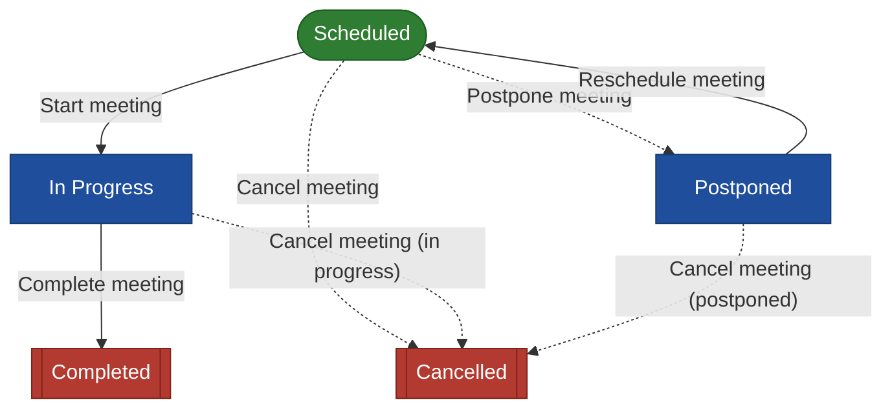

# Meeting workflow

Parliamentary meeting lifecycle (Events workflow): Scheduled → In Progress → Completed, with Postponed and Cancelled branches. Meetings cover House Plenary, committee, administration and other sitting types; agenda and minutes are attached documents and attendance is recorded against a per-meeting register.

